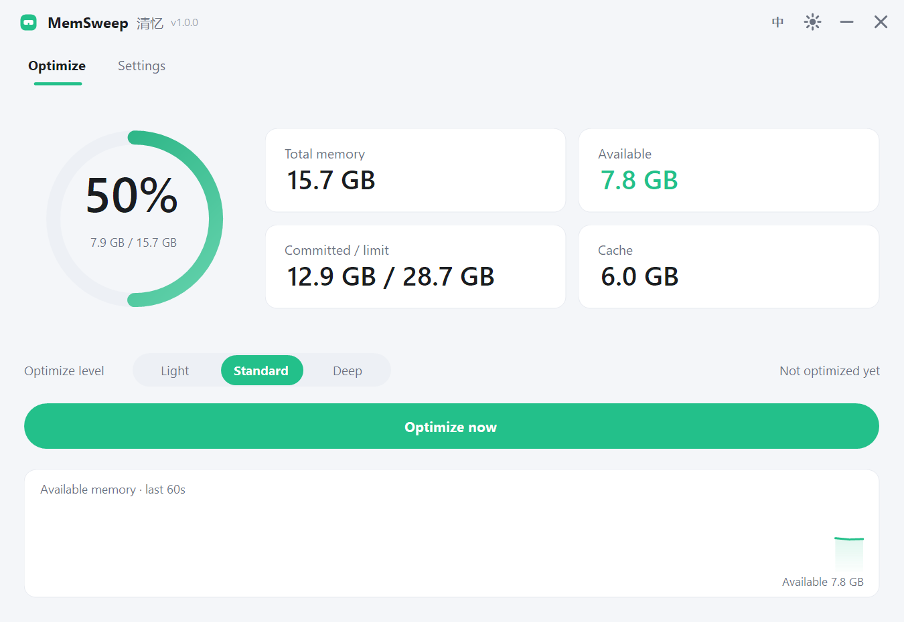

<div align="center">


# MemSweep · 清忆

**轻量级 Windows 内存优化工具 · A lightweight memory optimizer for Windows**

单文件 · 免安装 · 113 KB · 不联网 · 无遥测

[](https://github.com/caijun-1/memsweep/releases)
[](https://dotnet.microsoft.com/download/dotnet-framework)
[](#)
[](LICENSE)
[](https://github.com/caijun-1/memsweep/releases)

[简体中文](#中文文档) · [English](#english)

</div>

---

## 界面预览

| 浅色主题 | 深色主题 |
| :---: | :---: |
|  |  |

| 设置页 | English |
| :---: | :---: |
|  |  |

本文档：[简体中文](#中文文档) · [English](#english)

---

<a id="中文文档"></a>

# 中文文档

## 简介

MemSweep（中文名 **清忆**）是一款面向 Windows 的内存优化工具。它调用系统原生 API 释放进程工作集、清理文件缓存与待机内存列表，从而降低内存占用、提升可用内存。

整个程序只有一个 **113 KB** 的 exe 文件，双击即用，不需要安装、不需要运行库、不写入系统目录。

## 实测效果

在 16 GB 内存的 Windows 11 机器上执行一次「标准」档优化：

| 指标 | 优化前 | 优化后 |
| --- | --- | --- |
| 可用内存 | 8.35 GB | 10.89 GB |
| 内存负载 | 46% | 30% |
| 释放量 | — | **2.59 GB** |

处理进程 105 个，跳过无权访问的进程 20 个。

## 特性

- **单文件绿色版** — 113 KB，免安装，可放在 U 盘里直接用
- **极致低占用** — 私有内存约 17 MB，工作集约 40 MB
- **三档优化** — 轻量 / 标准 / 深度，按需选择释放强度
- **自动优化** — 定时（5–360 分钟）与智能触发两种模式；智能模式在内存紧张时按阈值自动执行，带 20 分钟冷却
- **释放来源拆分** — 优化结果显示工作集 / 缓存 / 备用列表各释放了多少
- **开机自启动** — 启动后最小化到托盘，不打扰日常使用
- **虚拟内存设置** — 一键填入推荐参数，支持自定义初始/最大值
- **中英双语** — 界面文字实时切换，无需重启
- **深浅主题** — 两套配色，跟随手动切换
- **托盘常驻** — 右键菜单可快速优化、开关自动优化
- **实时监控** — 环形仪表 + 四张统计卡 + 60 秒可用内存曲线

## 下载

前往 [Releases](https://github.com/caijun-1/memsweep/releases) 下载最新版 `MemSweep.exe`，双击运行即可。

> 由于包含可执行文件，首次运行时 Windows SmartScreen 可能提示「已保护你的电脑」。点击「更多信息」→「仍要运行」即可。这是未签名程序的通用提示，并非病毒。

## 使用说明

### 优化档位

| 档位 | 执行内容 | 权限 | 适用场景 |
| --- | --- | --- | --- |
| 轻量 | 释放后台进程的工作集，不动前台窗口 | 普通用户 | 日常轻度使用、不想打断正在用的程序 |
| 标准 | 释放全部可访问进程的工作集 + 清理系统文件缓存 | 普通用户（清缓存需管理员） | **默认推荐**，兼顾效果与稳定 |
| 深度 | 标准 + 清空待机内存列表 + 刷新修改页列表 | **需管理员** | 释放量最大，适合大型游戏/剪辑前 |

点击「立即优化」后，界面会显示本次释放的内存量。若需要深度档的完整效果，请在「设置 → 关于」处确认当前权限为「管理员」，否则程序会静默跳过需要提权的步骤（不会报错）。

### 自动优化

在「设置 → 自动优化」中开启，支持两种模式：

**定时模式** — 固定间隔执行，可设 5–360 分钟。

**推荐 30 分钟。** 这是收益与代价的平衡点：间隔过短不会带来额外收益，反而会让程序频繁重新从磁盘加载被释放的页面，拖慢响应；超过 1 小时则意义有限。

**智能触发** — 不按固定时间，而是持续观察内存压力，命中任一阈值时执行：

| 条件 | 默认阈值 |
| --- | --- |
| 已提交内存占比 | 85% |
| 内存负载 | 85% |
| 待机列表占比 | 25% |

为避免抖动，条件需**连续 3 次采样**都命中才会真正执行；执行后进入 **20 分钟冷却**，冷却期内不再触发。三个阈值都可以在设置页按机器情况自行调整。

关闭主窗口时程序默认最小化到托盘，定时器与智能监控继续工作；要彻底退出请在托盘右键菜单中选择「退出」。

### 虚拟内存

程序会读取当前页面文件配置，并给出推荐值：

| 参数 | 推荐值（16 GB 内存） | 计算方式 |
| --- | --- | --- |
| 初始大小 | **4096 MB** | 物理内存 ÷ 4，钳制在 2048–8192 |
| 最大值 | **8192 MB** | 初始大小 × 2，上限 16384 |

操作步骤：「设置 → 虚拟内存」→「使用推荐值」→「应用」。

- 修改需要**管理员权限**，且**重启后生效**
- 如果当前是「系统自动管理」，且内存 ≥ 16 GB、不运行大型软件，保持默认也是合理选择
- 修改会写入 `HKLM\SYSTEM\CurrentControlSet\Control\Session Manager\Memory Management\PagingFiles`

## 优化原理

MemSweep 只做「让内存回到可回收状态」这件事，不做任何有风险的操作：

1. **进程工作集整理** — 调用 `EmptyWorkingSet`，把进程物理内存中不活跃的页面转移到待机列表或页面文件
2. **系统文件缓存清理** — 通过 `NtSetSystemInformation(SystemFileCacheInformation)` 缩小文件缓存上限
3. **待机列表清理** — 通过 `NtSetSystemInformation(SystemMemoryListInformation)` 清空待机列表与修改页列表，需要 `SeProfileSingleProcessPrivilege` 权限

程序**从不**结束任何进程、不修改进程优先级、不改变系统服务状态。

> 客观说明：Windows 的内存管理本身是高效的，待机内存（Standby）本质上是「可随时释放的缓存」，并不等于被浪费。内存优化的实际收益主要体现在「可用内存数字立即变好看」以及少数场景下的页面回收，长期使用收益有限。MemSweep 力求把这一点如实呈现在界面上，而不是制造虚假的「已优化 XX GB」。

## 系统要求

- Windows 10 1809 及以上 / Windows 11
- .NET Framework 4.8（Windows 10 1903+ 与 Windows 11 已内置）
- 深度优化与虚拟内存设置需要管理员权限，其余功能普通权限可用

## 从源码构建

不需要安装 .NET SDK、Visual Studio 或任何 NuGet 包，只使用系统自带的 C# 编译器：

```powershell
# 在项目根目录执行
powershell -ExecutionPolicy Bypass -File build.ps1
```

产物为项目根目录下的 `MemSweep.exe`。构建脚本使用
`C:\Windows\Microsoft.NET\Framework64\v4.0.30319\csc.exe` 编译 `src` 下的全部源文件，
源码按 C# 5 语法编写以兼容该编译器。

## 项目结构

```
memsweep/
├─ src/
│  ├─ Program.cs          入口：单实例互斥、命令行参数、托盘
│  ├─ Native.cs           Win32 P/Invoke 声明
│  ├─ MemoryEngine.cs     内存采样与三档优化
│  ├─ Settings.cs         配置读写、开机自启、虚拟内存
│  ├─ I18n.cs             中英文文案
│  ├─ Theme.cs            浅色 / 深色配色
│  └─ UI/
│     ├─ MainForm.cs      主窗口（无边框、自绘标题栏）
│     ├─ SettingsPage.cs  设置页
│     └─ Controls.cs      自绘控件（圆环、卡片、开关、分段器、曲线）
├─ docs/                  README 截图与图标
├─ assets/app.ico         程序图标
├─ app.manifest           DPI 感知与权限声明
├─ build.ps1              构建脚本
└─ MemSweep.exe           构建产物
```

配置文件位于 `%APPDATA%\MemSweep\settings.ini`，删除该文件即可恢复默认设置。

## 更新记录

### 1.0.1

- 修复：设置页的自动优化、开机自启、启动最小化等开关点击后不生效
- 新增：智能触发模式，按已提交内存 / 内存负载 / 待机占比阈值自动优化
- 新增：优化结果显示工作集、缓存、备用列表各自的释放量
- 优化：设置页自动优化卡片高度随模式自适应，智能模式下展示阈值说明
- 优化：Toast 提示改为真正的圆角胶囊，去掉外层矩形底

## 常见问题

**优化后可用内存很快又降回去了？**
正常现象。被释放的页面会在程序需要时重新载入，Windows 也会重新缓存文件。优化是「一次性回收」，不是持续压制。

**为什么深度档没有明显效果？**
深度档的待机列表清理需要管理员权限。请右键以管理员身份运行，或在设置页确认当前权限。

**会自动结束进程来省内存吗？**
不会，永远不会。程序只调用工作集整理，不触碰任何进程的生命周期。

**为什么只有 113 KB？**
因为它就是原生 Win32 + .NET Framework 应用，没有打包浏览器内核、没有内嵌运行时、没有前端框架。

**杀毒软件报毒？**
未签名的个人项目 exe 偶有误报。源码完全公开，可自行用 `build.ps1` 编译核对。

## 许可证

本项目采用 [MIT License](LICENSE) 开源。

## 免责声明

本工具仅通过 Windows 官方 API 释放可回收的内存缓存，不结束进程、不修改系统设置（虚拟内存设置除外，且需用户主动确认）。
任何因使用本工具造成的系统异常或数据损失，作者不承担责任，请自行评估风险后再使用。

---

<a id="english"></a>

# English

## Overview

MemSweep is a lightweight memory optimizer for Windows. It releases process working sets, trims the system file cache, and purges the standby memory list through native Windows APIs to lower memory usage and raise available memory.

The entire application is a single **113 KB** executable. No installer, no runtime to download, no files written outside `%APPDATA%`.

## Measured results

One "Standard" pass on a Windows 11 machine with 16 GB of RAM:

| Metric | Before | After |
| --- | --- | --- |
| Available memory | 8.35 GB | 10.89 GB |
| Memory load | 46% | 30% |
| Released | — | **2.59 GB** |

105 processes trimmed, 20 skipped due to insufficient privileges.

## Features

- **Single portable executable** — 113 KB, no installation, runs from a USB drive
- **Tiny footprint** — about 17 MB private memory, 40 MB working set
- **Three optimization levels** — Light / Standard / Deep
- **Automatic optimization** — scheduled (every 5 to 360 minutes) or smart trigger; smart mode runs when memory pressure crosses thresholds, with a 20-minute cooldown
- **Release breakdown** — shows how much came from working sets, cache, and the standby list
- **Run at startup** — starts minimized to the system tray
- **Virtual memory settings** — one-click recommended values, or set custom sizes
- **Chinese and English UI** — switch instantly, no restart required
- **Light and dark themes**
- **Tray integration** — quick optimize and auto-optimize toggle from the context menu
- **Live monitoring** — ring gauge, four stat cards, and a 60-second availability chart

## Download

Get the latest `MemSweep.exe` from [Releases](https://github.com/caijun-1/memsweep/releases) and run it directly.

> Windows SmartScreen may warn about an unsigned executable on first launch. Click "More info" → "Run anyway". This is a standard prompt for unsigned software, not a virus warning.

## Usage

### Optimization levels

| Level | What it does | Privileges | When to use |
| --- | --- | --- | --- |
| Light | Trims background process working sets, leaves the foreground window alone | Standard user | Everyday use without interrupting active apps |
| Standard | Trims all accessible processes + clears the system file cache | Standard user (cache clearing needs admin) | **Recommended default** |
| Deep | Standard + purge standby list + flush modified page list | **Administrator** | Maximum release, e.g. before gaming or video editing |

Tap "Optimize now" and the amount released is shown immediately. If you want the full effect of the Deep level, make sure the app reports "Administrator" under Settings → About; otherwise the privileged steps are skipped silently instead of failing.

### Automatic optimization

Enable it under Settings → Auto optimize. Two modes are available:

**Scheduled** — runs at a fixed interval from 5 to 360 minutes.

**30 minutes is recommended.** It is the balance point between benefit and cost: shorter intervals bring no extra benefit and force programs to reload pages from disk, while intervals beyond an hour rarely matter.

**Smart trigger** — ignores the clock and watches memory pressure instead, firing when any threshold is crossed:

| Condition | Default |
| --- | --- |
| Committed memory | 85% |
| Memory load | 85% |
| Standby list share | 25% |

To avoid flapping, a condition must hold for **3 consecutive samples** before it runs, and a **20-minute cooldown** follows each run. All three thresholds are adjustable in the settings page.

Closing the main window minimizes to the tray and both the timer and the smart monitor keep running. Use "Exit" in the tray menu to quit completely.

### Virtual memory

MemSweep reads the current page file configuration and suggests values:

| Parameter | Recommended (16 GB RAM) | Formula |
| --- | --- | --- |
| Initial size | **4096 MB** | Physical RAM ÷ 4, clamped to 2048–8192 |
| Maximum size | **8192 MB** | Initial × 2, capped at 16384 |

Steps: Settings → Virtual memory → "Use recommended" → "Apply".

- Changing it requires **administrator rights** and takes effect **after a reboot**
- If the system is currently managed automatically and you have 16 GB or more of RAM and do not run large workloads, leaving it alone is equally reasonable
- The value is written to `HKLM\SYSTEM\CurrentControlSet\Control\Session Manager\Memory Management\PagingFiles`

## How it works

MemSweep only returns memory to a reclaimable state and never performs risky operations:

1. **Process working set trimming** — `EmptyWorkingSet` moves inactive pages of a process to the standby list or page file
2. **System file cache trimming** — `NtSetSystemInformation(SystemFileCacheInformation)` lowers the file cache limit
3. **Standby list purge** — `NtSetSystemInformation(SystemMemoryListInformation)` clears the standby list and flushes the modified page list; requires `SeProfileSingleProcessPrivilege`

The app **never** terminates processes, changes process priorities, or modifies system services.

> A note on expectations: Windows already manages memory efficiently. Standby memory is cache that can be reclaimed at any time, not wasted memory. Real gains are mostly a faster drop in the reported memory load plus page reclamation in a few workloads. MemSweep tries to be honest about this instead of advertising a fake "XX GB optimized".

## Requirements

- Windows 10 1809 or later / Windows 11
- .NET Framework 4.8 (bundled with Windows 10 1903+ and Windows 11)
- Administrator rights for the Deep level and virtual memory settings; everything else works as a standard user

## Build from source

No .NET SDK, Visual Studio, or NuGet package is required — only the C# compiler that ships with Windows:

```powershell
# Run from the project root
powershell -ExecutionPolicy Bypass -File build.ps1
```

The output is `MemSweep.exe` in the project root. The script compiles every file under `src` with
`C:\Windows\Microsoft.NET\Framework64\v4.0.30319\csc.exe`. Sources are written in C# 5 syntax to stay compatible with that compiler.

## Project layout

```
memsweep/
├─ src/
│  ├─ Program.cs          Entry point: single instance, CLI flags, tray
│  ├─ Native.cs           Win32 P/Invoke declarations
│  ├─ MemoryEngine.cs     Sampling and the three optimization levels
│  ├─ Settings.cs         Configuration, autostart, virtual memory
│  ├─ I18n.cs             Chinese / English strings
│  ├─ Theme.cs            Light and dark palettes
│  └─ UI/
│     ├─ MainForm.cs      Frameless window with custom title bar
│     ├─ SettingsPage.cs  Settings page
│     └─ Controls.cs      Custom-drawn controls (ring, cards, switch, segmented, chart)
├─ docs/                  Screenshots and logo used by this README
├─ assets/app.ico         Application icon
├─ app.manifest           DPI awareness and privilege declaration
├─ build.ps1              Build script
└─ MemSweep.exe           Build output
```

Settings live in `%APPDATA%\MemSweep\settings.ini`. Delete the file to restore defaults.

## Changelog

### 1.0.1

- Fixed: switches on the settings page (auto optimize, run at startup, start minimized) did not respond to clicks
- Added: smart trigger mode driven by committed memory / memory load / standby share thresholds
- Added: release breakdown by working sets, cache, and standby list
- Improved: the auto-optimize card resizes to its mode and explains the thresholds in smart mode
- Improved: toast is now a true rounded pill with no rectangular backdrop

## FAQ

**Available memory drops again shortly after optimizing.**
That is expected. Released pages are faulted back in when programs need them, and Windows re-caches files. Optimization is a one-time reclaim, not a permanent cap.

**The Deep level does not seem to do much.**
Purging the standby list requires administrator rights. Run the app as administrator, or check your privilege level under Settings → About.

**Does it kill processes to free memory?**
No, never. It only trims working sets and never touches process lifetimes.

**Why is it only 113 KB?**
It is a native Win32 + .NET Framework application with no browser engine, no embedded runtime, and no front-end framework.

**Antivirus flags it.**
Unsigned hobby-project executables sometimes trigger false positives. The full source is public — rebuild it with `build.ps1` to verify.

## License

Released under the [MIT License](LICENSE).

## Disclaimer

This tool only releases reclaimable memory through official Windows APIs. It does not terminate processes or change system settings, except for the virtual memory option, which requires explicit user confirmation.
The author is not responsible for any system instability or data loss resulting from the use of this tool. Evaluate the risks before use.